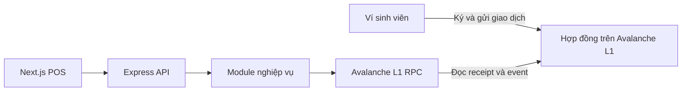

# Kiến trúc backend

Tạo invoice và QR đã ký: xem [hướng dẫn B01](../docs/b01-invoices.md) cho cấu hình, POST mẫu và điểm nối kho receipt B02.

IntraCampus dùng **modular monolith** cho MVP. Mỗi nhóm nghiệp vụ có module riêng dưới `src/modules/`, và tất cả chạy trong một ứng dụng Express. Nhóm có thể phát triển theo task và vẫn chạy cả API bằng một lệnh.

## Cách đặt code

- `src/server.ts` đọc cấu hình khởi động và mở cổng. `src/app.ts` lắp middleware, endpoint health check và router của các module.
- `*.routes.ts` kiểm tra đầu vào HTTP, gọi service và trả mã trạng thái. `*.service.ts` xử lý nghiệp vụ, dùng kiểu dữ liệu của module và có thể được gọi từ HTTP hoặc CLI. Module `network` là ví dụ đang chạy.
- Khi cần lưu dữ liệu hoặc đọc hợp đồng phức tạp, đặt lớp truy cập dữ liệu hoặc RPC trong module sở hữu nghiệp vụ. Khi nhiều module thực sự dùng chung một client, tách client đó ra làm hạ tầng chung. Cấu hình chain lấy từ `packages/network/`.
- Nếu hai module cần trao đổi, gọi hàm public của module sở hữu dữ liệu. Ví dụ, `copilot` có thể gọi chức năng đọc hóa đơn đã được kiểm tra quyền của `invoices`. Quyền thanh toán, giá cuối và chống trả trùng do hợp đồng quyết định.

| Module | Trách nhiệm | Task |
| --- | --- | --- |
| `src/modules/network/` | Kiểm tra RPC và chain ID cho `GET /api/network` và `pnpm rpc:check`. Đã có. | Nền tảng |
| `src/modules/invoices/` | Tạo hóa đơn và chữ ký QR ở POS. Đọc receipt và kiểm tra event để cập nhật cùng vòng đời hóa đơn. Indexer và WebSocket cho biên lai thuộc phần mở rộng. | `B01`, `B02`, `B04`, `X03` |
| `scripts/` | Chứa lệnh seed cho ví, thẻ và học bổng demo. | `B03`, `B05` |
| `src/modules/grants/` | Đọc dữ liệu học bổng cho demo. | `B05` |
| `src/modules/copilot/` | Tra cứu số dư và chi tiêu từ dữ liệu đã xác minh. Xem trước giao dịch thuộc phần mở rộng. | `B06`, `X02` |

Chốt payload EIP-712, ABI sự kiện và giao kèo HTTP theo `P02` trước khi nối các phần thanh toán. Xem đường dẫn đề xuất trong từng task trên [bảng sprint](https://intracampus-l1-sprint.mphung2532.chatgpt.site).

## B02 · Tra cứu biên nhận

`GET /api/invoices/:invoiceId?txHash=...` đã có router, RPC adapter và service theo [giao kèo P02](../docs/api-contract.md). Invoice phải tồn tại trong kho trước khi tra cứu. B01 gọi `SqliteInvoiceRepository.create(envelope)` sau khi ký và trước khi trả 201; dùng cùng instance/path với `ReceiptService`. B02 không cung cấp endpoint công khai để nhập envelope hoặc tự tạo hóa đơn fixture.

`server.ts` mở SQLite qua `node:sqlite` của Node 24, mặc định `backend/data/invoices.sqlite`. Bản ghi giữ envelope, hash đang theo dõi, snapshot gần nhất, cursor quét log và receipt đã xác minh. Receipt được commit trước khi trả `paid`; unique event key và cập nhật có điều kiện giữ kết quả paid khi GET lặp hoặc có snapshot cũ. SQLite dùng WAL và synchronous FULL. Giữ file DB và các file WAL liên quan trên volume bền vững; dùng cơ chế backup SQLite khi tiến trình đang chạy. Khi tắt sạch, có thể sao lưu DB rồi khởi động lại cùng path.

Cấu hình trong `backend/.env`:

| Biến | Nguồn / hành vi |
| --- | --- |
| `INTRACAMPUS_RPC_URL` | RPC tin cậy L02; mỗi lookup chưa paid xác minh chain `20261` |
| `CAMPUS_PAYMENT_REGISTRY_ADDRESS` | Địa chỉ verifier thật do L06 bàn giao |
| `CAMPUS_PAYMENT_DEPLOYMENT_BLOCK` | Block triển khai của cùng verifier, số nguyên thập phân |
| `INVOICES_DB_PATH` | Tùy chọn; nên dùng absolute path trên volume bền vững |

Thiếu cả hai biến deployment thì server vẫn khởi động; invoice đã lưu trả 503 khi cần đọc chain. Chỉ điền một biến hoặc giá trị sai định dạng làm startup thất bại. Verifier trong envelope phải khớp cấu hình tin cậy. Sau khi reset L1, giữ DB cũ để đối chiếu và dùng DB/cấu hình deployment mới; không dùng chain ID giống nhau để kết luận lịch sử vẫn còn.

Service tìm event theo verifier + invoiceId, chia khoảng 1.000 block và tối đa 10 khoảng mỗi lookup. Cursor chỉ tăng sau khi khoảng đã quét xong, có quét lại block đầu mút. Nếu getter báo paid nhưng chưa lấy được receipt thì rewind cursor và trả 503 để khôi phục khoảng log bị thiếu. Timestamp block quyết định hết hạn. Hash chưa xác minh được giữ lại khi lỗi mạng hoặc hóa đơn hết hạn; hint mới không ghi đè hash đang chưa rõ kết quả.

POS/B04/U04 gọi GET mỗi 2 giây khi đang chờ; gặp 503 thì dùng `Retry-After` và `error.retryable` để backoff. Backend giới hạn đọc RPC với backoff 2/4/8/16/30 giây cho mỗi invoice và tối đa bốn call RPC đồng thời. Không tự ký hoặc gửi lại giao dịch. UI chỉ báo thanh toán lần đầu cho khóa `(chainId, contractAddress, txHash, logIndex)`. Server chỉ ghi một log `invoice_paid` sau commit; `invoice_poll` ghi trạng thái/mã lỗi, không ghi URL RPC, chữ ký hay khóa.

Kiểm tra: `pnpm --filter @intracampus/backend test`, `pnpm --filter @intracampus/backend typecheck` và `pnpm --filter @intracampus/backend test:b02:evidence`. [Bàn giao B02](../docs/b02-receipts.md) mô tả bằng chứng và các phần chờ tích hợp.
