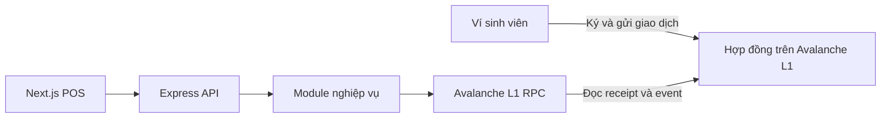

# Kiến trúc backend

IntraCampus dùng **modular monolith** cho MVP. Mỗi nhóm nghiệp vụ có module riêng dưới `src/modules/`, và tất cả chạy trong một ứng dụng Express. Nhóm có thể phát triển theo task và vẫn chạy cả API bằng một lệnh.

## Cách đặt code

- `src/server.ts` đọc cấu hình khởi động và mở cổng. `src/app.ts` lắp middleware, endpoint health check và router của các module.
- `*.routes.ts` kiểm tra đầu vào HTTP, gọi service và trả mã trạng thái. `*.service.ts` xử lý nghiệp vụ, dùng kiểu dữ liệu của module và có thể được gọi từ HTTP hoặc CLI. Module `network` là ví dụ đang chạy.
- Khi cần lưu dữ liệu hoặc đọc hợp đồng phức tạp, đặt lớp truy cập dữ liệu hoặc RPC trong module sở hữu nghiệp vụ. Khi nhiều module thực sự dùng chung một client, tách client đó ra làm hạ tầng chung. Cấu hình chain lấy từ `packages/network/`.
- Nếu hai module cần trao đổi, gọi hàm public của module sở hữu dữ liệu. Ví dụ, `copilot` có thể gọi chức năng đọc hóa đơn đã được kiểm tra quyền của `invoices`. Quyền thanh toán, giá cuối và chống trả trùng do hợp đồng quyết định.

| Module | Trách nhiệm | Task |
| --- | --- | --- |
| `src/modules/network/` | Kiểm tra RPC và chain ID cho `GET /api/network` và `pnpm rpc:check`. Đã có. | Nền tảng |
| `src/modules/invoices/` | Tạo hóa đơn và chữ ký QR ở POS. Đọc receipt và kiểm tra event để cập nhật cùng vòng đời hóa đơn. Indexer và WebSocket cho biên lai thuộc phần mở rộng. | `B01`, `B02`, `B04`, `X03` |
| `scripts/` | Chứa lệnh seed cho ví, thẻ và học bổng demo. | `B03`, `B05` |
| `src/modules/grants/` | Đọc dữ liệu học bổng cho demo. | `B05` |
| `src/modules/copilot/` | Tra cứu số dư và chi tiêu từ dữ liệu đã xác minh. Xem trước giao dịch thuộc phần mở rộng. | `B06`, `X02` |

Chốt payload EIP-712, ABI sự kiện và giao kèo HTTP theo `P02` trước khi nối các phần thanh toán. Xem đường dẫn đề xuất trong từng task trên [bảng sprint](https://intracampus-l1-sprint.mphung2532.chatgpt.site).
