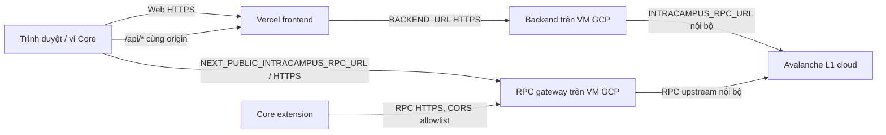

# Deploy demo online · Vercel + Google Cloud

Runbook vận hành cho demo cloud IntraCampus. Web chạy trên Vercel; backend,
RPC gateway và node Avalanche L1 chạy trên VM Google Cloud. Ví Core và trình
duyệt kết nối tới RPC HTTPS công khai; trình duyệt gọi API nghiệp vụ cùng origin
qua rewrite của Next.js.

> **Mạng online của demo:** chain ID `20261120`, đồng gốc `CAMPUS` (18 decimals),
> manifest `deployments/intracampus-cloud.json`. Chain local `20261` và manifest
> `deployments/intracampus.json` là profile khác. Không dùng RPC, địa chỉ hợp đồng,
> receipt hoặc số dư của profile này cho profile kia.

## Sơ đồ kết nối

Ba URL sau có mục đích khác nhau, không thay cho nhau:

| Cấu hình | Nơi dùng | Giá trị cần có |
| --- | --- | --- |
| `BACKEND_URL` | Server Next.js trên Vercel | Origin HTTPS của API trên VM, không kèm đường dẫn hay thông tin đăng nhập. Next rewrite dùng origin này để chuyển `/api/*` được hỗ trợ tới backend. |
| `NEXT_PUBLIC_INTRACAMPUS_RPC_URL` | Bundle trình duyệt và ví | RPC gateway HTTPS công khai, thường kết thúc bằng `/rpc`. URL được đưa vào JavaScript phía client nên không chứa API key/token bí mật. |
| `INTRACAMPUS_RPC_URL` | Backend/Foundry trên VM | RPC nội bộ mà VM truy cập được, thường là RPC node trên loopback hoặc mạng riêng. Không đưa URL nội bộ vào bundle trình duyệt. |

## 1. Chọn profile cloud

`NEXT_PUBLIC_INTRACAMPUS_CHAIN_ID=20261120` phải được đặt nhất quán trong build
frontend, môi trường backend và các lệnh Foundry/exporter/seed cần chain đã chọn.
`packages/network` dùng giá trị này để chọn `deployments/intracampus-cloud.json`;
để trống thì mặc định về chain local `20261` và `deployments/intracampus.json`.
Không chỉ đổi RPC URL: chain ID, manifest, backend RPC và ví phải cùng profile.

Manifest cloud hiện được đánh dấu `deployed` và chứa địa chỉ/ABI/bằng chứng công
khai. Không ghi RPC URL, private key, cookie đăng nhập hoặc token vào manifest,
Git, URL phía trình duyệt hay ảnh/log chia sẻ. Khi có thay đổi hợp đồng, dùng
[quy trình L06](deployment.md) để kiểm chứng và xuất đúng manifest cloud; không
ghi đè manifest local.

## 2. Cấu hình backend trên VM GCP

Đặt biến trong cấu hình môi trường của dịch vụ trên VM, không commit giá trị thật
vào repo. Dùng `backend/.env.example` để đối chiếu tên biến:

- `NEXT_PUBLIC_INTRACAMPUS_CHAIN_ID=20261120` và `INTRACAMPUS_RPC_URL` trỏ tới
  RPC cloud nội bộ; `pnpm rpc:check` phải trả `ready` và chain `20261120`.
- Dùng các ví public của demo cho `CAMPUS_SCHOOL_WALLETS`,
  `CAMPUS_TREASURY_ADDRESS` và các địa chỉ merchant. Chỉ khóa cần giao dịch do
  nhà trường/người vận hành ký được đưa vào ví của người ký; backend không giữ
  private key cấp tiền.
- Điền origin HTTPS chính xác đang được dùng cho `CAMPUS_AUTH_ORIGIN` và
  `LIBRARY_AUTH_ORIGIN`. Origin là `scheme://host`, không có path. Preview URL
  thay đổi có thể không khớp allowlist; dùng domain ổn định hoặc cập nhật origin
  theo deployment đang nghiệm thu.
- Đặt `CAMPUS_ALLOW_LOCAL_ANVIL=false` và `LIBRARY_ALLOW_LOCAL_ANVIL=false`.
- Đặt bốn đường dẫn SQLite tuyệt đối, khác nhau và nằm trên đĩa bền vững của VM:
  `INVOICES_DB_PATH`, `LIBRARY_DB_PATH`, `CANTEEN_DB_PATH`, `CAMPUS_DB_PATH`.
  (Tùy chọn thêm `ADMIN_DB_PATH` cho trang quản trị test `/admin`; nếu để trống
  trên cloud demo, backend tự tạo `admin.sqlite` cùng thư mục với `CAMPUS_DB_PATH`.)
  Vercel không lưu các database này. Trước khi triển khai thay đổi cấp CAMPUS
  hoặc bật quyền Native Minter, hãy tạo snapshot đĩa VM và sao lưu nhất quán
  các SQLite database (bao gồm Campus/Admin) bằng SQLite backup API/CLI, rồi
  kiểm tra khả năng mở bản sao lưu. Không sao chép riêng file `.db` khi WAL
  đang hoạt động. Bản sao lưu giữ dữ liệu ứng dụng; nó không thể hoàn tác CAMPUS
  đã mint trên chain.
- Cấu hình trang quản trị test nội bộ `/admin` (ẩn khỏi thanh điều hướng công khai,
  không cần nối ví để vào): đặt `ADMIN_ACCESS_KEY` (key cố định dùng chung cả nhóm
  trên mọi máy) và `ADMIN_AUTH_ORIGIN` (origin Vercel HTTPS, hỗ trợ danh sách cách
  nhau dấu phẩy). Nếu muốn bấm đổi ví đích / cấp SBT / giải ngân `FOOD` ngay trên
  `/admin`, đặt các khóa vận hành test trên VM (`ADMIN_REGISTRY_SIGNER_PRIVATE_KEY`,
  `ADMIN_LIBRARY_SIGNER_PRIVATE_KEY`, `ADMIN_SBT_ISSUER_PRIVATE_KEY`,
  `ADMIN_GRANT_ISSUER_PRIVATE_KEY`, `ADMIN_FUNDER_PRIVATE_KEY`); không đưa bất kỳ
  khóa hoặc `ADMIN_ACCESS_KEY` nào lên Vercel hay Git.
- Lưu ý đổi ví Thư viện (`treasury` và `librarian`): cần redeploy riêng
  `LibraryDepositEscrow` bản mới có `setTreasury`/`setLibrarian` qua `DeployLibrary.s.sol`
  và cập nhật phần `library` trong `deployments/intracampus-cloud.json` bằng
  `export-library-deployment.mjs` (3 contract còn lại giữ nguyên).

Backend cần lắng nghe trên địa chỉ/cổng mà dịch vụ HTTPS/tunnel trên VM có thể
truy cập. Giữ RPC node và cổng quản trị không public; chỉ công bố backend API và
RPC gateway cần cho demo.

## 3. Cấu hình RPC gateway

RPC public phải trỏ tới đúng node cloud và trả chain `0x1352900` (`20261120`).
Gateway chỉ cho phép các JSON-RPC method cần thiết; không mở toàn bộ node API,
namespace quản trị hoặc cổng AvalancheGo ra Internet.

Allowlist CORS gồm origin chính xác của từng frontend Vercel cần dùng và origin
đúng của Core extension nếu Core gọi gateway trực tiếp. Không dùng wildcard.
Thay đổi allowlist cần khởi động lại gateway. Kiểm tra `eth_chainId`,
`eth_blockNumber`, `eth_getBalance` (chỉ ví demo) và CORS preflight từ từng
origin cần hỗ trợ. HTTPS tunnel Quick Tunnel có hostname tạm; nếu hostname đổi,
cập nhật cả nơi dùng RPC và cấu hình tương ứng rồi kiểm tra lại.

Lưu ý: [runbook L02](../infra/rpc.md) hướng dẫn gateway/tunnel cho node local
chain `20261`; các lệnh trong đó không phải hướng dẫn endpoint cloud `20261120`.

## 4. Cấu hình Vercel

Chọn đúng scope cho Preview hoặc Production. Thiết lập các biến trước khi build:

| Biến | Giá trị cho cloud demo |
| --- | --- |
| `NEXT_PUBLIC_INTRACAMPUS_CHAIN_ID` | `20261120` |
| `NEXT_PUBLIC_INTRACAMPUS_RPC_URL` | URL HTTPS RPC gateway cloud, ví dụ `https://<rpc-host>/rpc` |
| `BACKEND_URL` | Origin HTTPS API backend trên VM, ví dụ `https://<api-host>` |
| `NEXT_PUBLIC_ALLOW_LOCAL_ANVIL` | `false` |

Các địa chỉ `NEXT_PUBLIC_*` khác nếu đang cấu hình phải khớp manifest cloud;
manifest là nguồn ABI và địa chỉ chuẩn của ứng dụng. Không đặt private key,
seed phrase hoặc RPC token trong bất kỳ biến `NEXT_PUBLIC_*` nào.

`NEXT_PUBLIC_*` được nhúng lúc build và `BACKEND_URL` được dùng để tạo rewrite.
Sau khi đổi biến hoặc source, tạo deployment mới/redeploy. Kiểm tra deployment
đó thuộc đúng branch và đang dùng cùng profile cloud với backend. Thử Preview
trước; Production phải có scope/env/origin riêng được xác minh.

## 5. Kiểm tra sau deploy

1. Mở `https://<app-host>/api/network`: phải có `status: ready`,
   `expectedChainId` và `chainId` đều là `20261120`.
2. Mở `https://<app-host>/api/deployment`: phải trả deployment đã xác minh cho
   chain `20261120`, không phải `DEPLOYMENT_NOT_READY` hoặc manifest local.
3. Từ trình duyệt app và Core, xác nhận RPC trả chain `20261120`; đọc balance của
   đúng ví demo và đối chiếu với RPC độc lập. Số dư native của mạng là `CAMPUS`.
4. Kiểm tra các luồng GET/login/read-only trước. Khi thử thanh toán hoặc cấp tiền,
   tạo yêu cầu mới, xác nhận chain/địa chỉ/số CAMPUS trong ví và chỉ gửi một lần.
   Với kết quả chưa rõ hoặc đã có hash, tra cứu giao dịch cũ; không gửi lại.
5. Ghi nhận URL deployment, branch/commit, chain, thời gian và kết quả probe.
   Không ghi private key, session cookie, challenge/signature hoặc RPC credential.

## Khi RPC hoặc hostname thay đổi

- Nếu RPC gateway public đổi hostname, cập nhật `NEXT_PUBLIC_INTRACAMPUS_RPC_URL`
  ở scope cần dùng, kiểm tra CORS cho đúng origin và redeploy Vercel.
- Nếu backend API đổi hostname, cập nhật `BACKEND_URL`, redeploy để áp dụng rewrite,
  rồi kiểm tra lại `/api/network`, login/session và route nghiệp vụ.
- Nếu RPC nội bộ hoặc node VM đổi, cập nhật `INTRACAMPUS_RPC_URL`, khởi động lại
  backend và chạy `pnpm rpc:check` trên VM.
- Sau mọi thay đổi, xác nhận cả ba cấu hình đang cùng chain `20261120`; không
  sửa RPC Core bằng URL cũ chỉ vì app còn mở được.
