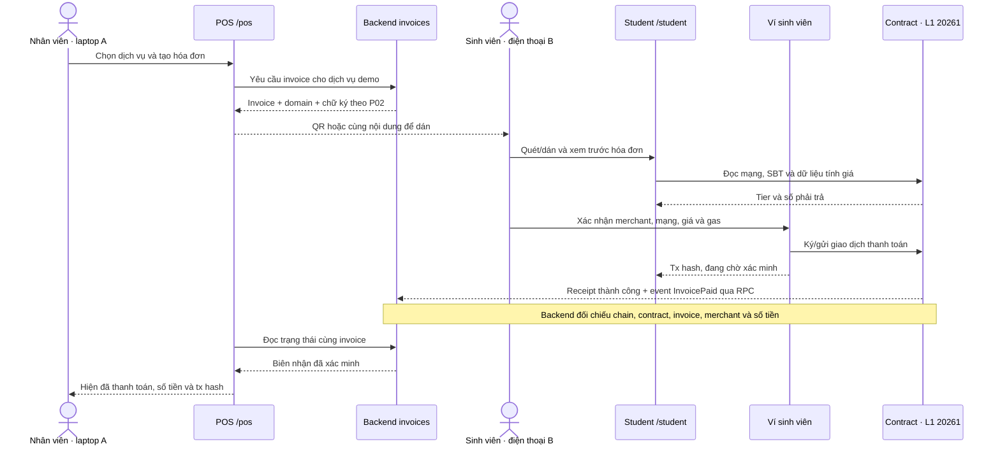

# P01 · Kịch bản demo IntraCampus L1 trên hai thiết bị

Ngày soạn: 08/11/2026. Trạng thái: kịch bản đề xuất để review và triển khai; chưa chạy thử trên L1. Phạm vi, cách làm luân phiên và dữ liệu đề xuất ở [scope.md](scope.md).

## 1. Chuẩn bị trước buổi chạy

Đây là checklist chuẩn bị khi các task triển khai đã hoàn thành. Repo hiện mới có khung ứng dụng; các nút và màn hình mô tả dưới đây là hành vi cần xây dựng.

| Hạng mục | Cách kiểm tra / điều kiện bắt đầu | Người phụ trách |
| --- | --- | --- |
| Thiết bị A | Laptop mở `<APP_URL>/pos`; thấy đúng merchant bãi xe và menu demo | Người vận hành POS của buổi demo |
| Thiết bị B | Điện thoại mở `<APP_URL>/student` bằng trình duyệt có kết nối ví EVM đã thử; camera được cấp quyền khi dùng quét | Người vận hành ví sinh viên |
| Đường truy cập | `APP_URL` là URL hai thiết bị truy cập được; API và RPC HTTPS đã cấu hình; không nhập `127.0.0.1` của laptop trên điện thoại | Người nhận L02 cùng người ghép frontend/backend |
| Chain | Cấu hình ví là chain `20261`; `pnpm rpc:check` trả `ready`; kiểm tra truy cập RPC từ cả hai thiết bị | Người nhận task L tương ứng |
| Contract | ABI/địa chỉ theo bản L06; merchant bãi xe hoạt động; signer invoice được phép; vault cho phép căn-tin | Người nhận L06 và người tích hợp |
| Dữ liệu seed | Ví ưu đãi có SBT còn hạn; có ví thường đối chứng; các ví có CAMPUS đủ trả tiền/gas; grant và merchant đã seed | Người nhận B03/B05 |
| Giá và ưu đãi | Xác nhận số liệu mục 2 trùng P02, cấu hình contract và seed; nếu đổi thì sửa cả hai tài liệu P01 trước khi quay | Người nhận P02 và reviewer |
| Hóa đơn mới | Mỗi lần diễn tập tạo invoiceId mới; không dùng lại hóa đơn hết hạn hoặc đã trả | Người vận hành POS |
| Đường dán QR | Mở sẵn cuộc trò chuyện riêng giữa hai tài khoản demo trên A/B để chuyển nguyên văn nội dung QR; thử sao chép trên A và dán vào Student trên B trước buổi chạy | Hai người vận hành A/B |
| Bằng chứng dự phòng | Q02/Q04 bàn giao video MP4, ảnh biên nhận có tx hash và ghi chú bản deploy; đặt ở thư mục offline trên laptop, thử mở khi tắt mạng | Người nhận Q02/Q04 |

`APP_URL`, RPC, địa chỉ contract và đường dẫn file offline là thông tin của bản triển khai cần điền vào checklist buổi chạy tại Q02/Q04. Chưa có các giá trị đó thì chưa đủ điều kiện tuyên bố demo trực tiếp đã sẵn sàng. Không đưa khóa ký hay seed phrase vào checklist, QR hoặc video.

## 2. Số liệu và cách đọc kết quả

Bộ đề xuất để người diễn tập biết chính xác số nào cần xuất hiện:

- Gửi xe: giá gốc `3.000 CAMPUS`, giảm `10%` là `300 CAMPUS`, số trả `2.700 CAMPUS` cho ví SBT còn hạn. Ví thường/thẻ hết hạn trả `3.000 CAMPUS`.
- Giá gốc trong dữ liệu ký: `3000000000000000000000` đơn vị nhỏ nhất; hạn invoice đề xuất `300` giây. P02 chốt domain, schema và quy tắc thời gian.
- Học bổng: số dư vault của sinh viên `5.000 CAMPUS`, chi căn-tin `1.000`, còn `4.000`. Lần gửi sang ví ngoài allowlist không làm thay đổi số dư grant hoặc chuyển tiền tới ví đó.
- Gas hiển thị riêng. Số dư ví cá nhân sau giao dịch thanh toán giảm cả số tiền gửi và gas; không so sánh nó như thể chỉ giảm `2.700 CAMPUS`. Giao dịch grant revert vẫn có thể tốn gas nếu đã được đưa lên chain.

Đây là thông số demo đề xuất, chưa phải chính sách ưu đãi đã triển khai. Chỉ đọc những số này trong demo sau khi đối chiếu với cấu hình thật. Ghi riêng invoiceId và tx hash thực tế của từng lượt; không điền hash giả làm bằng chứng.

## 3. Sơ đồ bàn giao

QR bàn giao dữ liệu invoice có chữ ký hoặc cách truy xuất nó theo giao kèo P02, không chứa khóa ký. Backend đọc receipt qua RPC và polling trong MVP; sơ đồ không ngụ ý đã có indexer/WebSocket. Tên endpoint và ABI được chốt ở P02/L04.

## 4. Kịch bản trình diễn 3 phút

Đây là phân bổ thời lượng thuyết trình đề xuất, không phải cam kết độ trễ của L1. Nếu giao dịch đang chờ thì giữ đúng trạng thái và dùng quy trình dự phòng ở mục 5. Chuẩn bị trước màn hình grant/Copilot và phiên ví để giảm thao tác thiết lập khi quay.

| Thời gian | Người / màn hình | Đầu vào và thao tác | Kết quả quan sát được |
| --- | --- | --- | --- |
| 00:00–00:15 | Thuyết trình; A và B | Giới thiệu nhân viên bãi xe và sinh viên demo. Chỉ mạng trên A; trên B mở `/student`, kết nối ví SBT và xác nhận `20261` | Hai thiết bị cùng mạng; B hiện ví demo, số dư và thẻ còn hạn |
| 00:15–00:35 | Nhân viên; A `/pos` | Chọn “Một lượt gửi xe demo”, merchant “Bãi xe demo”; bấm tạo hóa đơn | A hiện QR, invoiceId mới, giá `3.000 CAMPUS`, thời hạn và trạng thái chờ thanh toán |
| 00:35–00:55 | Sinh viên; B `/student` | Mở quét QR và quét trên A. Nếu camera lỗi, dán cùng nội dung QR theo mục 5 | B hiện cùng invoiceId/merchant, chain `20261`, giá gốc, tier, giảm `300` và phải trả `2.700 CAMPUS` |
| 00:55–01:20 | Sinh viên; B và ví | Đọc merchant, địa chỉ contract, mạng, số tiền và gas; bấm thanh toán rồi xác nhận trong ví | Ví gửi giao dịch; B có tx hash và trạng thái đang chờ. A chưa báo đã thanh toán chỉ vì có hash |
| 01:20–01:35 | Nhân viên; A `/pos`; sinh viên B | Chờ backend đọc và xác minh receipt. Đối chiếu invoiceId và tiền ở hai màn hình | Receipt thành công và `InvoicePaid` khớp: A/B hiện đã thanh toán; biên nhận có tx hash, giá gốc `3.000`, giảm `300`, đã trả `2.700` |
| 01:35–01:45 | Sinh viên; B, cùng invoice | Mở lại invoice đã trả. Nếu kiểm tra replay on-chain, dùng bộ test đã chuẩn bị thay vì gửi một giao dịch có thể tốn gas trong lượt quay | UI hiện đã trả, không cho thanh toán lần hai; bằng chứng contract từ L04 cho thấy replay bị từ chối |
| 01:45–02:10 | Sinh viên; B, bảng học bổng | Mở grant đã seed, chọn căn-tin hợp lệ, nhập `1.000 CAMPUS`, xem trước và xác nhận bằng ví | Trước giao dịch có `5.000`; sau receipt thành công còn `4.000`; có tx hash và merchant nhận đúng khoản chi |
| 02:10–02:25 | Sinh viên; B, bảng học bổng | Chọn ví cá nhân/merchant ngoài allowlist, thử khoản chi `1.000 CAMPUS` | Hiện lỗi merchant không hợp lệ; số dư grant vẫn `4.000`, merchant ngoài allowlist không nhận tiền. UI chặn trước khi gửi hoặc contract từ chối theo bằng chứng test/receipt |
| 02:25–02:45 | Sinh viên; B, Copilot | Hỏi “Số dư CAMPUS của mình là bao nhiêu?”, sau đó “Chuyển 100 CAMPUS cho ví này” | Câu đọc khớp nguồn và có thời điểm; yêu cầu chuyển tiền bị từ chối, không có cửa sổ ký hay giao dịch được tạo |
| 02:45–03:00 | Thuyết trình; A biên nhận và B | Chỉ lại biên nhận, grant và nguồn Copilot; nói rõ đang chạy trực tiếp hay xem bản ghi | Người xem xác định được luồng thanh toán, điều kiện ưu đãi, giới hạn grant và ranh giới Copilot |

Nếu Copilot chưa nghiệm thu ở Q02, video có thể dành phần thời gian đó để giải thích biên nhận; ghi rõ Copilot chưa được trình diễn. Đây là lựa chọn nội dung video theo Q04, không tự đánh dấu B06/U06 hoàn thành hoặc bỏ chúng khỏi phạm vi MVP.

## 5. Kịch bản lỗi và dự phòng

Các nhãn dưới đây diễn đạt hành vi UI cần có; tên enum và mã lỗi chính thức thuộc P02. Thành viên thứ ba theo dõi thời gian, ghi nhận lỗi và mở tài liệu/video khi cần. Ba người có thể đổi vai giữa các buổi.

| Tình huống / màn hình | Thao tác và mốc chuyển | Kết quả đúng cần quan sát |
| --- | --- | --- |
| Camera không đọc QR trên B | Thử lại một lần; sau tối đa `10` giây, A sao chép nội dung QR vào cuộc trò chuyện riêng của hai tài khoản demo đã mở sẵn; B sao chép tin đó và dán vào ô nhập trên `/student`. Chỉ chuyển payload/link công khai, không chứa khóa | Cùng invoiceId và dữ liệu ký; B kiểm tra chữ ký, hạn, mạng như khi quét. Không sửa amount để bỏ qua lỗi; cơ chế quét/dán được xây trong U03 |
| QR hết hạn | A tạo invoice mới; B quét/dán bản mới và xem lại số tiền trước khi ký | B báo hết hạn với invoice cũ; bản mới có invoiceId mới, không tái sử dụng chữ ký cũ |
| QR bị sửa hoặc sai signer/contract | B nhập mẫu đã thay dữ liệu được chuẩn bị khi kiểm thử P02/L04 | Báo dữ liệu/chữ ký không hợp lệ, không báo đã thanh toán; contract vẫn kiểm tra khi nhận giao dịch |
| Ví sai mạng | Trên B chuyển ví sang mạng khác trong buổi kiểm thử; sau đó trở lại `20261` | Hiện sai mạng và chặn gửi mới tới khi đúng mạng; không ký/gửi invoice sang chain khác |
| Người dùng từ chối trong ví | Từ chối xác nhận rồi trở lại B | Chưa thanh toán; có thể thử lại khi invoice còn hạn. Không hiện tx hash hoặc trạng thái đã gửi khi ví chưa gửi |
| RPC mất trước khi gửi | Dừng gửi mới, kiểm tra kết nối/hotspot và thử đọc lại một lần; chuyển video nếu không khôi phục trong `20` giây | A/B báo không xác minh được mạng/dữ liệu; không dùng receipt giả hoặc mở ví với giá chưa xác minh |
| RPC mất sau khi có tx hash | Giữ invoiceId/tx hash, báo đang chờ xác minh, thử đọc lại sau khi nối mạng; không tự gửi lại. Nếu sau `20` giây vẫn không đọc được, chuyển video | Khi mạng về, tra giao dịch cũ rồi cập nhật trạng thái đúng; nếu chưa tìm thấy thì tiếp tục chưa xác minh. Chỉ cho thử lại sau khi xác định giao dịch cũ thất bại hoặc không được gửi, xử lý invoice còn hạn |
| Giao dịch revert | Mở receipt/test đã chuẩn bị trong buổi kiểm thử | Hiện thất bại và lý do nếu đọc được; POS không báo đã trả. Không giả định số dư ví cá nhân giữ nguyên vì có thể mất gas |
| Copilot/model/RPC phục vụ chat lỗi | Cho tối đa `10` giây rồi hiển thị timeout/thiếu dữ liệu; tiếp tục giải thích biên nhận | Không bịa số dư; lỗi chat không khóa POS hay thao tác ví nếu hạ tầng thanh toán còn hoạt động |
| Không thể tiếp tục demo trực tiếp | Theo mốc RPC ở trên, người thứ ba mở MP4 đã thử offline từ bộ Q04; nếu video lỗi, dùng ảnh/receipt đã ghi có nhãn và tx hash | Thông báo “Bản ghi trước — không phải giao dịch trực tiếp”; không đánh dấu invoice đang chờ là đã trả |

Mốc `10`/`20` giây là ngân sách thao tác trình diễn do P01 đề xuất, không phải timeout API, SLA hoặc kết quả đo hiệu năng. Q01 đo độ trễ thực tế riêng. Hotspot và đường dán QR phải được Q02 chạy thử trên hai thiết bị; không mặc định chúng đã sẵn sàng.

## 6. Dữ liệu thật và dữ liệu minh họa

| Loại | Nội dung | Cách trình bày |
| --- | --- | --- |
| Dữ liệu demo giả lập | Persona, tên dịch vụ, merchant demo, các ví và khoản seed, mức giảm đã cấu hình | Nói rõ là dữ liệu thử nghiệm; không dùng danh tính sinh viên thật |
| Trạng thái chạy trực tiếp | SBT, số dư, chữ ký, giao dịch, event và receipt thật trên L1 `20261` | Kèm mạng, địa chỉ contract và tx hash; tiền gas tách khỏi tiền dịch vụ |
| Fixture / EVM local | Mẫu chữ ký, kiểm thử lỗi, replay, grant hoặc contract ở local | Ghi môi trường fixture/local; không gọi là đã kiểm tra trên L1 |
| Bản ghi trước | Video, ảnh, receipt đã ghi từ một phiên demo trước | Gắn nhãn bản ghi và môi trường của phiên đó; không thay trạng thái phiên trực tiếp |

## 7. Kiểm tra và bàn giao

P01 kiểm tra khả năng đọc hiểu kịch bản. Sau khi có triển khai, Q02 kiểm tra chạy thật; mỗi tình huống có người chạy, bản deploy, thời gian, pass/fail và bằng chứng. Mở cả hai thiết bị, đối chiếu cùng invoiceId/tx hash, giữ một bộ ví nạp sẵn và dùng invoice mới cho mỗi lượt.

Các tình huống cần chạy khi triển khai xong: thanh toán ưu đãi; ví thường/thẻ hết hạn; QR hết hạn; chữ ký/domain bị sửa; sai mạng; từ chối ví; invoice đã trả; receipt thất bại hoặc event sai contract; camera lỗi; RPC mất trước/sau khi gửi; grant hợp lệ/ngoài allowlist/vượt số dư; Copilot đọc đúng/thiếu dữ liệu/từ chối chuyển tiền.

Q01 lưu log đo phí và độ trễ bằng tx hash thực. Q02 ghi kết quả tại `docs/demo-checklist.md` và lỗi còn chặn demo. Q04 chuẩn bị `docs/video-script.md`, `docs/demo-assets.md` và bộ offline; các file này thuộc task sau, chưa được tạo bởi P01.

Điều kiện đưa kịch bản này vào bản nộp: một thành viên khác thao tác lại được từ checklist, kết quả giá/receipt/grant khớp bản deploy, phần thật/giả lập được ghi rõ và file offline mở được khi không có mạng. Mọi sai khác về dữ liệu đề xuất phải được sửa đồng bộ trong [scope.md](scope.md) trước khi quay.
