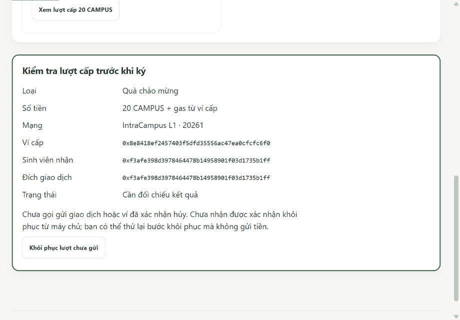
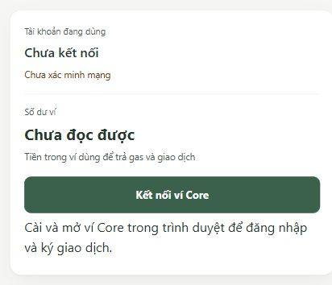

# Kiểm tra cổng sinh viên và nhà trường

Ngày 2026-11-20, trên nhánh `codex/student-verification-onboarding`, base main `4e9089b`. Dữ liệu hồ sơ, ví và RPC trong bằng chứng này đều là giả lập local; không chuyển CAMPUS thật, không mint SBT, không có giao dịch Avalanche L1 được tuyên bố ở đây.

## Kiểm tra tự động

- Node 24.22.3, pnpm 11.25.0.
- `pnpm typecheck`: qua.
- `pnpm test`: 616 test qua, 0 lỗi, 2 test tích hợp local EVM có sẵn được bỏ qua vì không cấu hình node Anvil tương ứng.
- `pnpm build`: qua, có ba route mới `/login`, `/student/verification`, `/staff/students`.
- `git diff --check`: qua.

Trong đó Campus có 13 test backend và 3 test frontend, kiểm tra xác minh chữ ký, nonce/replay/logout/rate limit, Origin, quyền trường, kích hoạt STUDENT, danh tính không trùng, duyệt học bổng riêng, khóa cấp tiền và receipt sai/revert/reorg. Receipt revert được lưu FAILED, không mở lượt thứ hai.

## Kiểm tra trên trình duyệt

Kết nối @Browser không hoạt động trong phiên kiểm tra. Dùng Microsoft Edge headless qua Playwright, frontend production tại loopback, API/SQLite trong bộ nhớ và EIP-1193 provider giả lập. Chữ ký challenge được tạo bằng hai ví ethers ngẫu nhiên riêng biệt, không bỏ qua bước xác minh chữ ký của API. Không thay `.env` hoặc canonical manifest để tạo bằng chứng.

Đã chạy qua các bước:

1. Trang login chưa có ví hiển thị hướng dẫn và chặn ký. Không tràn ngang tại 320, 390, 768 và 1440 px.
2. Ví sinh viên số dư 0 ký đăng nhập, gửi hồ sơ và thấy trạng thái chờ duyệt; chưa được tự xác nhận.
3. Ví nhà trường ký đăng nhập, nút duyệt khóa đến khi đánh dấu đã đối chiếu. Duyệt hồ sơ xong mới mở lượt cấp 20 CAMPUS.
4. Preview hiển thị 20 CAMPUS, ví cấp/nhận/đích và chain 20261. Provider fixture chỉ nhận một yêu cầu gửi; receipt fixture khớp mới cập nhật CONFIRMED, sinh viên thấy đã nhận.
5. Sinh viên đăng ký học bổng, nhà trường duyệt riêng. Chưa có deployment/event GrantIssued thì không hiển thị đã giải ngân.
6. Ví sinh viên mở URL nhà trường vẫn thấy không có quyền. Đăng xuất 204 xóa UI đã đăng nhập. Không có lỗi JavaScript trong các bước trên.

Trước chạy thật cần người phụ trách cấu hình ví duyệt, ví quỹ có CAMPUS/gas, RPC và deployment L06 theo [runbook](../../student-onboarding.md). Khóa lượt cấp có kết quả chưa rõ không được tự reset; MVP chưa hỗ trợ đổi ví/cấp lại hoặc nhiều học kỳ.

## Bổ sung sau review P1 của PR #38

Sửa trường hợp provider trả EIP-1193 `4001` khiến lượt cấp chưa gửi bị kẹt UNKNOWN. Backend thêm capability riêng cho từng lần begin và endpoint release đúng ví cấp; UI chỉ release khi WalletController xác nhận bị từ chối hoặc chưa gọi gửi. Không đưa token vào profile/list, không mở khóa attempt cũ hoặc lượt đã có hash. Khi mất phản hồi release, UI cho thử lại bước khôi phục trong tab hiện tại, không gọi gửi tiền.

- `pnpm typecheck`, `pnpm test`, `pnpm build`: qua; toàn bộ 623 test qua, 0 lỗi, 2 test local EVM có sẵn vẫn bỏ qua. Campus có 15 test backend và 8 test frontend, gồm 7 test hồi quy mới cùng kiểm tra HTTP bổ sung.
- Edge headless với ví/RPC giả lập: hủy 4001 trả cùng lượt về PREPARED; hủy lần nữa kèm lỗi mạng ở release hiển thị nút khôi phục; thử lại release không gọi ví; sau đó gửi thành công đúng một lần và xác nhận receipt.
- Một lượt cấp khác gặp lỗi provider chưa rõ kết quả vẫn UNKNOWN sau reload, chỉ có khôi phục bằng hash, không có nút gửi lại hoặc mở khóa. Tổng fixture có 4 lần gọi provider: 2 từ chối, 1 thành công, 1 kết quả chưa rõ; không lỗi JavaScript.
- Không thực hiện giao dịch L1 thật. UNKNOWN cũ không có capability hoặc đã mất token không được tự mở.

## P1 mất phản hồi begin và font tiếng Việt · 2026-11-21

Client tạo và giữ token trước request; begin nhận `{attemptToken}` và trả cùng attempt khi lặp lại token đang khóa. Release trước commit ghi dấu hủy để request begin bị chậm không khóa lại lượt cấp. Đã thêm kiểm tra release thắng race trong lúc mô phỏng gas, token đã hủy không tái sử dụng sau nhiều lần thử, và HTTP thật bị mất cả response begin/release sau commit.

- Typecheck và build qua; `pnpm test` có 629 test qua, 0 lỗi, 2 test local EVM có sẵn bỏ qua. Campus có 18 test backend và 11 frontend.
- Browser local dùng API/SQLite trong bộ nhớ và ví/RPC giả lập: ngắt JSON begin sau commit, ngắt JSON release sau commit; UI hiện nút khôi phục. Sau khôi phục, report là PREPARED, chưa hash, `walletCalls: 0`. Người dùng chủ động mở lại lượt cấp rồi thử lại: report CONFIRMED và `walletCalls: 1`. Không gửi tiền L1 thật.
- Font trạng thái “Chưa kết nối” ở Library đã tách khỏi font monospace của địa chỉ ví. Đã kiểm tra trên Browser: `font-family: Inter, "Segoe UI", system-ui, -apple-system, sans-serif`, weight 600. Trạng thái chưa kết nối ở login cũng dùng chữ giao diện; địa chỉ ví giữ font mã.

