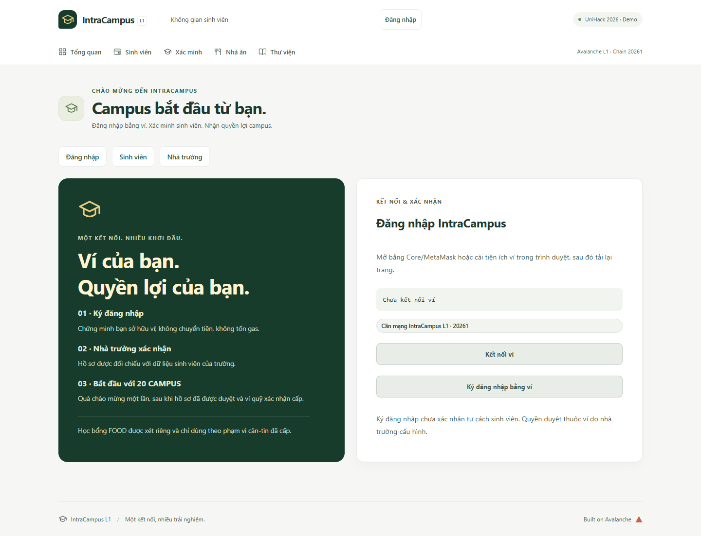
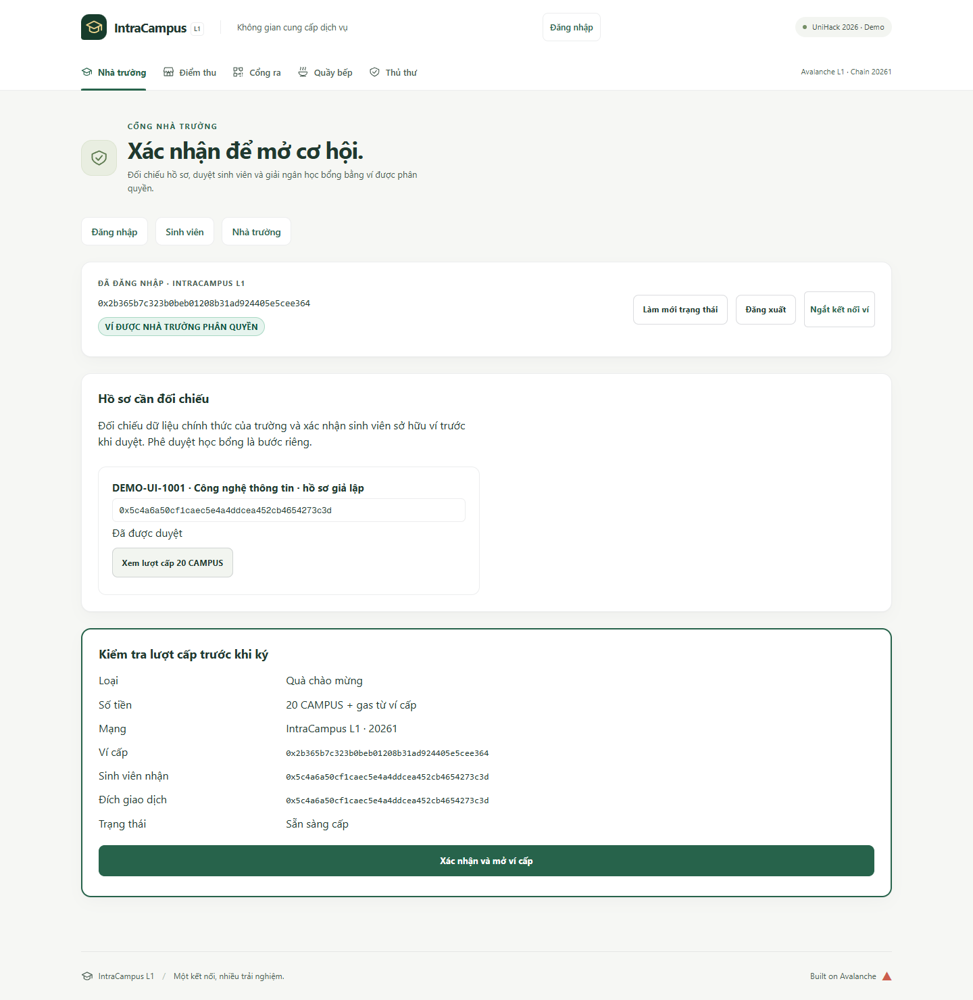

# Kiểm tra cổng sinh viên và nhà trường

Ngày 2026-11-20, trên nhánh `codex/student-verification-onboarding`, base main `4e9089b`. Dữ liệu hồ sơ, ví và RPC trong bằng chứng này đều là giả lập local; không chuyển CAMPUS thật, không mint SBT, không có giao dịch Avalanche L1 được tuyên bố ở đây.

## Kiểm tra tự động

- Node 24.22.3, pnpm 11.25.0.
- `pnpm typecheck`: qua.
- `pnpm test`: 616 test qua, 0 lỗi, 2 test tích hợp local EVM có sẵn được bỏ qua vì không cấu hình node Anvil tương ứng.
- `pnpm build`: qua, có ba route mới `/login`, `/student/verification`, `/staff/students`.
- `git diff --check`: qua.

Trong đó Campus có 13 test backend và 3 test frontend, kiểm tra xác minh chữ ký, nonce/replay/logout/rate limit, Origin, quyền trường, kích hoạt STUDENT, danh tính không trùng, duyệt học bổng riêng, khóa cấp tiền và receipt sai/revert/reorg. Receipt revert được lưu FAILED, không mở lượt thứ hai.

## Kiểm tra trên trình duyệt

Kết nối @Browser không hoạt động trong phiên kiểm tra. Dùng Microsoft Edge headless qua Playwright, frontend production tại loopback, API/SQLite trong bộ nhớ và EIP-1193 provider giả lập. Chữ ký challenge được tạo bằng hai ví ethers ngẫu nhiên riêng biệt, không bỏ qua bước xác minh chữ ký của API. Không thay `.env` hoặc canonical manifest để tạo bằng chứng.

Đã chạy qua các bước:

1. Trang login chưa có ví hiển thị hướng dẫn và chặn ký. Không tràn ngang tại 320, 390, 768 và 1440 px.
2. Ví sinh viên số dư 0 ký đăng nhập, gửi hồ sơ và thấy trạng thái chờ duyệt; chưa được tự xác nhận.
3. Ví nhà trường ký đăng nhập, nút duyệt khóa đến khi đánh dấu đã đối chiếu. Duyệt hồ sơ xong mới mở lượt cấp 20 CAMPUS.
4. Preview hiển thị 20 CAMPUS, ví cấp/nhận/đích và chain 20261. Provider fixture chỉ nhận một yêu cầu gửi; receipt fixture khớp mới cập nhật CONFIRMED, sinh viên thấy đã nhận.
5. Sinh viên đăng ký học bổng, nhà trường duyệt riêng. Chưa có deployment/event GrantIssued thì không hiển thị đã giải ngân.
6. Ví sinh viên mở URL nhà trường vẫn thấy không có quyền. Đăng xuất 204 xóa UI đã đăng nhập. Không có lỗi JavaScript trong các bước trên.

Trước chạy thật cần người phụ trách cấu hình ví duyệt, ví quỹ có CAMPUS/gas, RPC và deployment L06 theo [runbook](../../student-onboarding.md). Khóa lượt cấp có kết quả chưa rõ không được tự reset; MVP chưa hỗ trợ đổi ví/cấp lại hoặc nhiều học kỳ.
