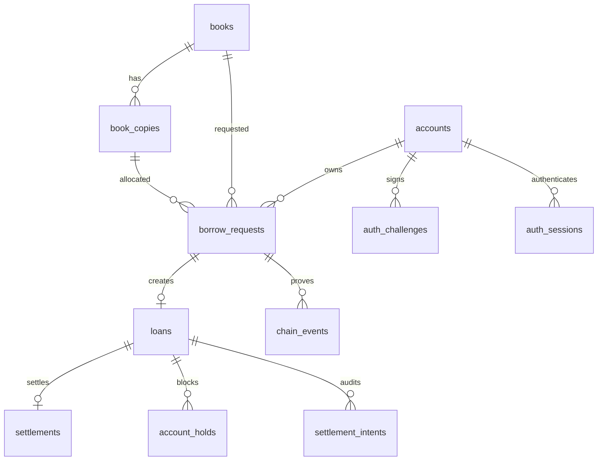

# Library backend and SQLite

This document describes the durable database foundation for the Library module. The backend is a single-instance demo service; SQLite is not a shared multi-writer store for multiple replicas.

## Database lifecycle

The default database is `backend/data/library.sqlite`. Set `LIBRARY_DB_PATH` to use another persistent path. Opening the database enables foreign keys on that connection, sets a 5-second busy timeout, enables WAL for file databases, and uses `synchronous=FULL`.

Schema changes use SQLite `user_version`. Each migration batch obtains `BEGIN IMMEDIATE` before reading the applied version, applies schema and version updates in one transaction, then commits. Concurrent starters serialize through SQLite's writer lock. A failed migration rolls back the schema and version together. There is no destructive down migration for populated data; introduce forward migrations instead.

`LibraryRepository.backupTo(path)` uses Node 24's online SQLite backup API, so it includes committed data consistently while WAL is active. To restore, stop the backend, preserve the current database and its WAL files, replace the configured database with the backup, then restart and check `/healthz` and the schema version. Keep backups outside Git and restrict access to them because they contain wallet-linked borrowing history.

## Relational model



Amounts are canonical unsigned decimal strings in wei. Database checks reject nondecimal text; application validation enforces the `uint256` range. Books and demo accounts are seed-owned: wallet/role and sealed deposit/replacement terms cannot be changed through SQL updates. Copy status and loan/request history are mutable projections updated from verified evidence.

The database enforces these invariants even when a caller bypasses repository methods:

- A request can hold a physical copy only while its state is active; a partial unique index allows one active allocation per copy.
- A loan's request, book, account and copy must match the same request row. The loan ID equals its request ID, and a partial unique index allows one active loan per copy.
- Each request creates at most one loan, each loan has at most one final settlement, and each verified event is unique by `(chainId, contractAddress, txHash, logIndex)`.
- Foreign keys are enabled for every connection. Seed terms, account wallet/role and verified chain events are immutable.

## Demo seed

`pnpm --filter @intracampus/backend seed:library` reads a private JSON file selected by `LIBRARY_SEED_FILE` and writes to `LIBRARY_DB_PATH`. The seed file contains catalog metadata, physical copy IDs/barcodes, and synthetic wallet addresses with `STUDENT` or `LIBRARIAN` roles. It must not contain private keys, signatures, student names, or student IDs.

Before writing, the command requires a valid Library deployment manifest and verifies that the seed contains the exact deployed book ID set, sealed deposit and replacement price for every book, and the one librarian wallet configured in escrow. Deposit must be exactly `50000000000000000000` wei (50 CAMPUS). Local Anvil deployment manifests require `LIBRARY_ALLOW_LOCAL_ANVIL=true`; the default is fail closed. Running the same seed version/content is a no-op. A different seed is rejected rather than silently replacing financial terms or demo identities.

Example shape (values are illustrative and must match the deployment manifest):

```json
{
  "version": 1,
  "books": [
    {
      "bookId": "0xaaaaaaaaaaaaaaaaaaaaaaaaaaaaaaaaaaaaaaaaaaaaaaaaaaaaaaaaaaaaaaaa",
      "title": "Demo title",
      "author": "Demo author",
      "isbn": null,
      "depositWei": "50000000000000000000",
      "replacementPriceWei": "30000000000000000000",
      "copies": [{ "copyId": "copy-001", "barcode": "LIB-001" }]
    }
  ],
  "accounts": [
    { "wallet": "0x1111111111111111111111111111111111111111", "role": "STUDENT" },
    { "wallet": "0x3333333333333333333333333333333333333333", "role": "LIBRARIAN" }
  ]
}
```

## Identity and privacy

The demo allowlist is stored in `accounts`; role comes from that row and is never accepted from the browser. Challenge messages are persisted exactly as issued so verification checks the signed message, configured origin and chain. A successful verify consumes the challenge and creates a session in the same write transaction. Challenge nonce replay is prevented by a unique constraint and conditional consume. Session cookies contain a random opaque token; SQLite stores only its SHA-256 hash. Disabling an account revokes its sessions in the same transaction, and every session lookup also checks that the account remains enabled.

Rate-limit subjects are stored only as SHA-256 hashes, not raw client addresses. Do not log challenge messages, nonce, signatures, raw session cookies, private keys, or database rows. Wallet addresses and borrowing history remain demo data and should not be populated with real student identities.

### Auth HTTP settings and cookie flow

Auth configuration is independent of invoice/grant configuration so missing Library auth settings return `503 CONFIGURATION_ERROR` from `/api/auth/*` without disabling unrelated APIs. There are no production defaults.

| Environment variable | Meaning |
| --- | --- |
| `LIBRARY_AUTH_ORIGIN` | Exact trusted application origin; the server derives the EIP-4361 domain from this value and never trusts `Host` or forwarded-host headers. |
| `LIBRARY_CHALLENGE_TTL_SECONDS`, `LIBRARY_SESSION_TTL_SECONDS` | Positive integer TTLs whose expiry remains within the JavaScript date range used for auth timestamps. If the current time makes a configured TTL exceed that range, the auth route fails closed with `503 CONFIGURATION_ERROR`. |
| `LIBRARY_CHALLENGE_RATE_LIMIT_MAX_REQUESTS`, `LIBRARY_CHALLENGE_RATE_LIMIT_WINDOW_SECONDS` | Positive request count and fixed-window seconds for challenge attempts. |
| `LIBRARY_VERIFY_RATE_LIMIT_MAX_REQUESTS`, `LIBRARY_VERIFY_RATE_LIMIT_WINDOW_SECONDS` | Positive request count and fixed-window seconds for verify attempts. |
| `LIBRARY_ALLOW_INSECURE_LOCALHOST` | Must be exactly `true` to allow HTTP on `localhost`, `127.0.0.1`, or `::1`; it never enables non-loopback HTTP. |

Production uses HTTPS and the host-only `__Host-library_session` cookie (`Secure; HttpOnly; SameSite=Strict; Path=/`, with no `Domain`). Explicit local HTTP uses `library_session` without `Secure` only after the loopback opt-in. `POST /api/auth/challenge`, `POST /api/auth/verify`, and `POST /api/auth/logout` require an `Origin` exactly matching `LIBRARY_AUTH_ORIGIN`. Challenge and verify are JSON-only and share the 8192-byte Library parser limit. A throttled attempt returns `429 RATE_LIMITED`, `retryable: true`, and `Retry-After` seconds until its fixed window resets.

The browser flow is: request a challenge with its wallet, sign the exact message in the wallet, submit only the challenge ID and signature, keep the session cookie out of JavaScript, call `/api/auth/session` with that cookie, and POST logout to revoke it. Verify responses contain the allowlisted account and expiry but never the raw session token; only the `Set-Cookie` header carries that token.

## API runtime and reconciliation

`backend/src/server.ts` mounts the Library API with the existing invoice and grants APIs. Library settings are read independently; missing or invalid settings leave unrelated routes available and Library calls fail closed with `503 CONFIGURATION_ERROR`.

| Environment variable | Requirement |
| --- | --- |
| `INTRACAMPUS_RPC_URL` | Required. HTTPS, or HTTP on loopback for local development. Credentials, query strings and fragments are rejected. |
| `LIBRARY_ALLOW_LOCAL_ANVIL` | Set exactly `true` to accept a `local-anvil` deployment manifest; otherwise local manifests are rejected. |
| `LIBRARY_CHAIN_MAX_STALE_SECONDS` | Required positive integer; maximum age of the safe block timestamp. |
| `LIBRARY_CHAIN_MAX_FUTURE_DRIFT_SECONDS` | Required nonnegative integer; maximum safe-block timestamp drift into the future. |
| `LIBRARY_MIN_CONFIRMATIONS` | Required positive integer; safe head is `latest - (confirmations - 1)`. |

Before returning Library data or accepting a lifecycle action, the server reads `eth_chainId` from the configured RPC, checks the deployment verification block and escrow runtime code, then reconciles at most ten 1,000-block ranges per pass. Multi-block ranges with more than 2,000 raw logs are subdivided recursively. A single block that still returns more than 2,000 raw logs fails closed with retryable `503 RPC_UNAVAILABLE`; that block and later blocks do not advance the SQLite cursor. The current RPC client has no within-block log pagination, so retries alone cannot resolve a persistently over-cap block; it requires an operational/provider change or a separately designed pagination checkpoint. A pass also rechecks at most 200 previously canonical events, resuming from a SQLite cursor that rotates through the event history across requests and restarts. Log verification runs in waves of 16; each event uses at most four independent reads (transaction, receipt, block, and deposit terms), keeping a wave at or below 64 calls under the provider's 100-call batch cap. Up to 100 submitted transactions are checked per pass with a durable rotating hash cursor, so older pending transactions do not starve behind absent receipts. A status-zero receipt is marked reverted only after its block is at or below the safe head and the canonical block hash matches. A log is projected only after its transaction, successful receipt, canonical block hash, escrow address, calldata, sender, and lifecycle event agree. Deposit terms are also read from the escrow at the safe block. The chain cursor and event projections commit in one SQLite transaction; pending requests expire only after the cursor reaches the safe head. RPC loss, an unknown result, or a detected reorg cannot create a success state. Reorg health stays fail closed for operator investigation.

These values bound request work, database writes, and provider batches; they are local operational limits, not claims about IntraCampus L1 capacity. Node 24 fixture tests establish that 10,001 blocks require two passes (the first cursor stops at 10,000), dense multi-block results subdivide, a single-block result of 2,001 logs fails without advancing beyond that block (exactly 2,000 is accepted), a 200-event canonicality page fits in at most two 100-call batches, 50 log verifications peak at 16 concurrent events, and 101 pending transactions rotate across passes and after restart. Each authentication cleanup statement deletes at most 256 expired rows; the 257-row challenge fixture leaves one expired row for the next cleanup. Concurrent startup tests complete both database initializations in about 90 ms locally; the WAL mode retry is capped at 10 seconds with 10 ms sleeps as a startup-only recovery ceiling. Recheck these limits against the target RPC and expected data volume before claiming deployment readiness; L1 RPC performance and capacity have not been validated here.

The API runs one bounded reconciliation pass before a chain-dependent call. If it is behind, the response is retryable `503 STALE_CHAIN_STATE` with `Retry-After`; the caller may retry, and reconciliation resumes from the persisted cursor. No backend route signs or broadcasts a wallet transaction.

Operators can also run one bounded pass from the backend package directory:

```powershell
pnpm.cmd --filter @intracampus/backend library:reconcile
```

The command reads the same `.env`, manifest and `LIBRARY_DB_PATH` as the server. It prints only safe-head/cursor counts and exits `0` when caught up, `2` when more bounded passes are needed, or `1` for configuration, RPC, database, or reconciliation failure. Re-run it to resume; it never broadcasts. The current manifest must be deployed and local Anvil must be explicitly enabled where applicable.

### Caller boundary for holds

`GET /api/grants/:beneficiary` now requires the authenticated session wallet to match `:beneficiary`; it returns the documented unverified response with `403 FORBIDDEN` while that account is held. New Library requests are held at the API and again under SQLite's write lock. `GET /api/library/account-status`, return requests, deposit refunds, settlement and shortfall payment remain available for recovery. POS invoice issuance remains a separate B04 flow; the student payment UI must check fresh account status before opening a new payment flow, while B05 grant reads go through the guarded same-origin endpoint. Neither B04 nor B05 trusts a client-supplied role or hold result.
