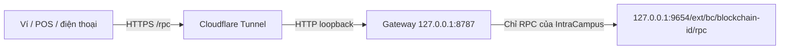

# L02 · RPC HTTPS cho hai thiết bị demo

Trạng thái ngày 08/11/2026: đã chuẩn bị gateway, script và hướng dẫn; chưa mở tunnel trên máy hwng, chưa có bằng chứng Wi-Fi/4G hoặc endpoint HTTPS hoạt động. Task chưa đủ điều kiện nghiệm thu.

Node L01 đang ở máy hwng, Ubuntu/WSL2. Node, gateway và tunnel bên dưới phải chạy trong cùng môi trường truy cập được RPC đó. Máy của BaoBao và điện thoại dùng URL HTTPS do hwng bàn giao, không dùng `127.0.0.1` của máy hwng.

## 1. Luồng kết nối và điều kiện



Gateway chỉ có `/rpc` cho JSON-RPC và `/check` là trang kiểm tra chỉ đọc do repo cung cấp. Trang `/check` không phải dashboard của node, không chứa khóa hoặc quyền quản trị. Các đường dẫn khác trả `404`. Không tunnel trực tiếp toàn bộ cổng `9654` và không mở các cổng node/router ra Internet.

Trước khi chạy, cần:

- Node L01 còn hoạt động và giữ lịch sử giao dịch. RPC trong [runbook L01](README.md) trả `0x4f25` và receipt thật.
- Node.js 24, Bash và `curl` trên Ubuntu/WSL của hwng; công cụ Node cũng là yêu cầu của repo. Gateway và script không thêm package npm.
- `cloudflared` được cài từ [nguồn chính thức](https://developers.cloudflare.com/cloudflare-one/connections/connect-networks/downloads/). Ghi `node --version` và `cloudflared --version` vào bằng chứng buổi chạy.
- Xác nhận origin web của ứng dụng. URL bảng sprint không phải origin của app Student/POS. Origin là `scheme://host[:port]`, không có path hoặc dấu `/` cuối.

Các lệnh Bash tiếp theo chạy từ thư mục gốc repo trên máy hwng. Kiểm tra thay đổi cục bộ trước khi chuyển nhánh; giữ công việc đang làm của đồng đội.

```bash
git status --short
git fetch origin
git switch codex/L02-https-rpc
node --version
cloudflared --version
```

Sau khi PR L02 được merge, có thể dùng `main` đã cập nhật thay cho nhánh trên.

## 2. Terminal 1: kiểm tra node và bật gateway

Giá trị dưới đây lấy từ bằng chứng L01. Nếu chủ máy đã reset/deploy lại, lấy RPC và tx hash mới từ lần chạy thật rồi cập nhật tài liệu; không dùng hash của lịch sử đã mất.

```bash
export RPC_UPSTREAM='http://127.0.0.1:9654/ext/bc/ei1KeTdVU9HTCEPGRgYUBAqpd7CyHxGJUDzoseXQFQHubTXfW/rpc'
export DEMO_TX_HASH='0xc5ba59aae9dd2bcf2aca95b10f05a0e540b7671fc4e3d70fc1537dc9156566b7'

curl -fsS --max-time 10 "$RPC_UPSTREAM" \
  -H 'Content-Type: application/json' \
  --data '{"jsonrpc":"2.0","id":1,"method":"eth_chainId","params":[]}'

export RPC_ALLOWED_ORIGINS='http://localhost:3000,http://127.0.0.1:3000'
node infra/rpc-gateway.mjs
```

Chỉ tiếp tục khi chain ID là `0x4f25` và gateway in `verified chain 20261`. `RPC_UPSTREAM` phải là HTTP loopback đúng đường `/ext/bc/<blockchain-id>/rpc`; gateway kiểm tra chain khi khởi động rồi giữ nguyên đích này. Không có fallback âm thầm sang C-Chain/Fuji hoặc đích truyền từ request.

`RPC_ALLOWED_ORIGINS` ở ví dụ chỉ cho web dev local. Khi có frontend HTTPS, thêm origin thật của nó vào danh sách phân cách bằng dấu phẩy và khởi động lại gateway. Trang `/check` trên cùng hostname tunnel dùng origin của chính nó; thêm hai origin tunnel vào danh sách sau khi lấy URL ở bước 3 để trang kiểm tra gọi `/rpc` được.

Gateway mặc định chỉ nghe `127.0.0.1:8787`; có thể đặt `RPC_GATEWAY_PORT` nếu trùng cổng. Node/tunnel ở Windows và gateway ở WSL phải thực sự truy cập được cùng loopback; cách dễ nhất là chạy cả gateway và `cloudflared` trong distro đang chạy L01.

## 3. Terminal 2: mở HTTPS và endpoint dự phòng

```bash
cloudflared tunnel --url http://127.0.0.1:8787
```

Lấy hostname HTTPS được in trong terminal, gọi là `PRIMARY_ORIGIN`. URL đưa vào ví/API là `<PRIMARY_ORIGIN>/rpc`; trang kiểm tra điện thoại là `<PRIMARY_ORIGIN>/check`. Không nối thêm `/ext/bc/...` sau `/rpc` vì gateway đã ánh xạ tới blockchain.

[Quick Tunnel](https://developers.cloudflare.com/tunnel/get-started/quick-tunnels/) phù hợp thử nghiệm, không cần domain/tài khoản; hostname đổi khi tạo lại và mất tác dụng khi tiến trình dừng. Giữ terminal/node chạy trong buổi demo. Nếu đã có cấu hình `cloudflared` riêng, xem giới hạn Quick Tunnel trong tài liệu chính thức và dùng tunnel riêng của nhóm thay vì sửa/xóa cấu hình đang có. Không đặt đăng nhập tương tác trước RPC dùng cho ví.

Để có endpoint dự phòng, mở Terminal 3 và chạy cùng lệnh với gateway `8787`, ghi hostname thứ hai là `BACKUP_ORIGIN`. Cả hai endpoint phải qua smoke test và cùng đọc được một receipt. Hai tunnel dùng cùng node/gateway: dự phòng này xử lý lỗi tunnel/URL; không xử lý việc máy hwng tắt hoặc node mất dữ liệu. Nếu nhóm đã có domain và named tunnel, có thể dùng hostname ổn định thay Quick Tunnel, vẫn trỏ qua gateway này.

Trở lại Terminal 1, dừng gateway bằng Ctrl+C, bổ sung các origin thật rồi chạy lại. Ví dụ Bash sau yêu cầu nhập đúng hai hostname vừa được cấp, không chứa `/rpc` hoặc `/check`:

```bash
read -r -p 'PRIMARY_ORIGIN (https://...): ' PRIMARY_ORIGIN
read -r -p 'BACKUP_ORIGIN (https://...): ' BACKUP_ORIGIN
export RPC_ALLOWED_ORIGINS="http://localhost:3000,http://127.0.0.1:3000,$PRIMARY_ORIGIN,$BACKUP_ORIGIN"
# Thêm origin frontend HTTPS thật vào danh sách trên khi đã có.
node infra/rpc-gateway.mjs
```

CORS chỉ giới hạn trình duyệt; nó không xác thực các client khác. Endpoint này là RPC của mạng demo, không giữ khóa ký và không thay cho hạ tầng RPC production.

## 4. Method và giới hạn gateway

| Nhóm | Method được phép |
| --- | --- |
| Mạng | `eth_chainId`, `net_version`, `net_listening`, `web3_clientVersion`, `eth_blockNumber` |
| Số dư / contract | `eth_getBalance`, `eth_getTransactionCount`, `eth_getCode`, `eth_call` |
| Xem trước phí | `eth_estimateGas`, `eth_gasPrice`, `eth_maxPriorityFeePerGas`, `eth_feeHistory` |
| Giao dịch / receipt / polling | `eth_getBlockByNumber`, `eth_getBlockByHash`, `eth_getTransactionByHash`, `eth_getTransactionReceipt`, `eth_getLogs` |
| Broadcast giao dịch đã ký tại ví | `eth_sendRawTransaction` |

`eth_requestAccounts`, `wallet_switchEthereumChain` và ký giao dịch thuộc ví/provider; gateway không giữ tài khoản mở khóa. `eth_sendTransaction`, `eth_sign`, `personal_*`, `admin*`, `debug*` và mọi method ngoài bảng đều bị từ chối. JSON-RPC batch có tối đa 20 call, phải có id; nếu bất kỳ call nào bị chặn thì toàn batch bị chặn trước khi gửi tới node. Không hỗ trợ notification hoặc WebSocket trong MVP.

Chỉ chấp nhận POST JSON vào đúng `/rpc`; preflight OPTIONS dành cho POST. Request tối đa 256 KiB, response tối đa 2 MiB, tối đa 8 request đang xử lý, timeout upstream 8 giây. Response quá lớn hoặc upstream lỗi trả lỗi gateway, không tạo receipt thành công. Đây là giới hạn demo, không phải cam kết hiệu năng; giới hạn khoảng block khi truy vấn logs để tránh response quá lớn.

Các đường `/`, `/ext/admin`, `/ext/info`, `/ext/health`, `/metrics`, `/dashboard`, URL blockchain gốc và cổng dịch vụ khác không được gateway chuyển tiếp. Tunnel chỉ được trỏ vào gateway `8787`.

## 5. Máy BaoBao/laptop: chạy smoke test

Mở terminal Bash mới, nhập endpoint và hash thật. Script chỉ đọc dữ liệu; probe quản trị bị gateway chặn. Cần Node.js 24 và Bash/Git Bash; Windows chưa có Node 24 thì dùng trang `/check` trong lúc chuẩn bị môi trường. `/check` không thay thế smoke test chặn route/method.

```bash
read -r -p 'RPC HTTPS URL (https://.../rpc): ' DEMO_RPC_HTTPS
read -r -p 'Transaction hash: ' DEMO_TX_HASH
bash infra/smoke-rpc.sh "$DEMO_RPC_HTTPS" "$DEMO_TX_HASH"
```

Script thoát `0` khi chain đúng `20261`, receipt có cùng hash, `status = 0x1`, đủ trường block/phí, các route ngoài phạm vi trả `404` và batch quản trị trả `403`. Mặc định chỉ chấp nhận HTTPS, xác minh TLS bình thường, không theo redirect. Nó không tự chứng minh client là điện thoại hoặc đang dùng 4G; ghi thiết bị và mạng thực vào bảng bằng chứng.

Để kiểm tra CORS của frontend, đặt `RPC_TEST_ORIGIN` đúng origin đã cho phép rồi chạy lại:

```bash
RPC_TEST_ORIGIN='http://localhost:3000' \
  bash infra/smoke-rpc.sh "$DEMO_RPC_HTTPS" "$DEMO_TX_HASH"
```

Có thể chạy `bash infra/smoke-rpc.sh --local http://127.0.0.1:8787/rpc "$DEMO_TX_HASH"` trên máy hwng trước khi mở tunnel. Kết quả `--local` được ghi nhãn test local, không phải bằng chứng HTTPS L02. Output thành công ghi UTC timestamp, endpoint và receipt; khi cần lưu dùng `> rpc-wifi.json`, kiểm tra nội dung trước khi đưa vào PR.

## 6. Điện thoại: Wi-Fi rồi 4G/5G

1. Mở `<PRIMARY_ORIGIN>/check` bằng trình duyệt điện thoại. Chọn mạng Wi-Fi đang dùng, dán tx hash thật và bấm Kiểm tra. Kết quả PASS phải có chain `20261` và receipt khớp hash.
2. Tắt Wi-Fi trên điện thoại, dùng 4G/5G; tải lại trang qua HTTPS, chọn đúng mạng và chạy lại. Lưu kết quả/ảnh cùng thời gian và tên thiết bị. Mục chọn mạng là lời xác nhận của người chạy, không phải phát hiện mạng tự động.
3. Mở `<BACKUP_ORIGIN>/check` trên 4G/5G và chạy cùng hash. Kiểm tra endpoint dự phòng trước khi đổi cấu hình ví/app.
4. Thêm mạng tùy chỉnh trong ví: tên IntraCampus L1, RPC `<PRIMARY_ORIGIN>/rpc`, chain ID `20261`, ký hiệu CAMPUS, không điền explorer khi chưa có. Đối chiếu số dư ví demo với RPC. Không cần nhập lại seed phrase để đổi RPC.

Sau khi L02 có endpoint, backend dùng `INTRACAMPUS_RPC_URL` trong `.env` cục bộ và chạy lại `pnpm rpc:check`; cấu hình ví/frontend dùng cùng mạng. Khi đổi sang dự phòng: giữ nguyên chain ID, sửa URL RPC trong ví và backend/cấu hình frontend tương ứng, restart tiến trình đọc biến môi trường, rồi đối chiếu lại cùng receipt. Với giao dịch đang chờ, tra tx hash cũ; không tự gửi lại để thử kết nối.

## 7. Xử lý lỗi

| Triệu chứng | Cách kiểm tra và xử lý |
| --- | --- |
| Local RPC không trả lời | Chủ máy kiểm tra node/distro/cổng và khởi động mạng L01 hiện có. Chỉ tạo lại mạng nếu chấp nhận mất lịch sử, sau đó cập nhật blockchain ID/hash |
| Gateway không khởi động | Kiểm tra `RPC_UPSTREAM`, chain ID, cổng `8787` và định dạng origin. Không đổi sang chain khác để bỏ qua lỗi |
| Tunnel 502/không kết nối | Giữ node và gateway chạy; xác nhận tunnel cùng distro truy cập `127.0.0.1:8787`. Nếu hostname hết hiệu lực, mở tunnel mới và cập nhật cả CORS/URL |
| Trình duyệt báo mixed content | App HTTPS phải gọi RPC HTTPS. HTTP loopback chỉ là kết nối bên trong máy node; không đưa URL HTTP của node vào frontend HTTPS. Không tắt bảo vệ trình duyệt hoặc bỏ kiểm tra TLS |
| curl chạy nhưng frontend báo CORS | Thêm đúng origin app vào `RPC_ALLOWED_ORIGINS`, restart gateway và thử preflight bằng `RPC_TEST_ORIGIN`. Không dùng wildcard để che lỗi cấu hình |
| Gõ `/rpc` trên thanh địa chỉ thấy 405 | Thanh địa chỉ gửi GET; JSON-RPC dùng POST. Để kiểm tra bằng trình duyệt, mở `/check` |
| Receipt là null | Đối chiếu tx hash và lịch sử của đúng blockchain. Không thay null bằng receipt mẫu; sau reset phải tạo/lấy hash mới |
| RPC trả 403 cho method | Đọc method ứng dụng thực sự cần; đối chiếu bảng, cập nhật allowlist và test trong PR nếu hợp lệ. Không mở toàn bộ RPC hoặc các namespace quản trị |
| 429, timeout hoặc lỗi logs lớn | Giảm polling, backoff và chia khoảng block; giữ trạng thái chưa xác minh. Không retry broadcast tự động |

Tham khảo: [Cloudflare Quick Tunnel](https://developers.cloudflare.com/tunnel/get-started/quick-tunnels/), [Subnet-EVM RPC](https://build.avax.network/docs/rpcs/subnet-evm), [Ethereum JSON-RPC](https://ethereum.org/developers/docs/apis/json-rpc/), [mixed content](https://developer.mozilla.org/en-US/docs/Web/Security/Defenses/Mixed_content).

## 8. Bằng chứng và điều kiện nghiệm thu

| Kiểm tra | Endpoint, thiết bị/mạng, thời điểm, kết quả | Trạng thái |
| --- | --- | --- |
| Node L01 / receipt nguồn | Runbook L01 có hash; cần kiểm tra lại trên máy hwng | Chưa chạy lại trong L02 |
| Primary HTTPS / smoke route + method + receipt | Chưa có URL/bản chạy | Chưa kiểm tra |
| Điện thoại / Wi-Fi | Chưa có thiết bị, thời điểm và kết quả | Chưa kiểm tra |
| Điện thoại / 4G/5G, đã tắt Wi-Fi | Chưa có thiết bị, thời điểm và kết quả | Chưa kiểm tra |
| Backup HTTPS / cùng receipt | Chưa có URL/bản chạy | Chưa kiểm tra |
| Frontend origin / preflight | Chưa có origin của bản triển khai | Chưa kiểm tra |

Thay các ô “chưa” bằng kết quả thật sau khi chạy: URL HTTPS, phiên bản công cụ, thời điểm, thiết bị/mạng, chain ID, tx hash và receipt. Bằng chứng từ điện thoại trên mạng di động là bắt buộc; test tự động local không thay thế nó. Chỉ nghiệm thu L02 sau khi đủ bằng chứng, L01 được đối chiếu và có thành viên khác review. Dừng tunnel bằng Ctrl+C sau buổi thử nếu không tiếp tục sử dụng.

Kiểm thử tự động của repo: `pnpm test:rpc` hoặc `node --test infra/test/rpc.test.mjs`. Test dùng HTTP/RPC giả lập ở loopback, kiểm tra gateway/script; không dựng Avalanche, không mở HTTPS công khai, không ký hay gửi giao dịch.
